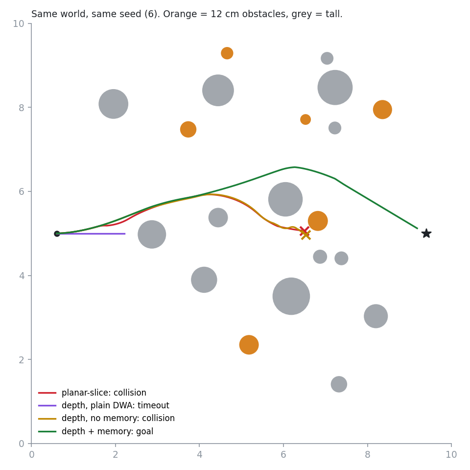
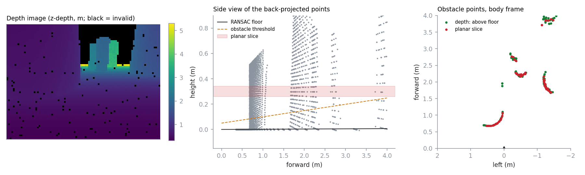

# vision-obstacle-avoidance

A differential-drive robot crosses a cluttered 10 m × 10 m floor using only a
forward depth camera. Each frame goes through the same chain: depth image,
back-projected point cloud, RANSAC floor fit, obstacle points, short-term
memory, free-space heading, dynamic-window velocity command, wheels. Four
variants of that chain are run on the same 100 seeded worlds, so each
difference in the results comes from one design choice.


This is a simulation study. There is no robot or camera behind any number
here, and no ROS 2 node in the repository. The depth images come from exact
ray casting against the scene, with a stereo-style noise model added on top.

---

## Result

100 worlds, each with 14 tall cylinders and 6 cylinders **12 cm high**. Before
use, every world is checked by grid search on the true map, inflated by the
robot radius, to confirm that a collision-free route from start to goal
exists. So when a run fails, the system failed, not the map.

| configuration | reached goal | collisions | of which 12 cm obstacles | timeouts |
|---|---:|---:|---:|---:|
| planar slice (2D-lidar equivalent) | 46 | 53 | 38 | 1 |
| depth, plain DWA | 10 | 8 | 5 | 82 |
| depth, no memory | 76 | 11 | 6 | 13 |
| **depth + memory** | **99** | **0** | **0** | **1** |

Raw table: [`docs/benchmark-100-worlds.txt`](docs/benchmark-100-worlds.txt).
Reproduce it with `python examples/benchmark.py --worlds 100`. That takes about
13 minutes on 8 cores.



Each row isolates one failure:

- **Planar slice.** This keeps only the points within ±4 cm of camera height
  (30 cm), which is what a 2D lidar at that mount would see. A 12 cm obstacle
  never enters that band. 38 of its 53 collisions are with obstacles it could
  not see.
- **Plain DWA.** The dynamic-window planner scores each candidate by where it
  ends up after 2 s. When an obstacle is squarely ahead, "stop and keep facing
  the goal" outscores "turn away", and the robot stalls a few centimetres
  short. That happened in 82 of 100 worlds.
- **No memory.** The camera's field of view is 87°, so it sees nothing within
  about 45° of either side. Once an obstacle leaves the frame it stops
  existing, and the planner turns into it. 8 of the 11 collisions hit
  something between 72° and 83° off the heading, where the camera could not
  look at that moment.
- **Depth + memory.** 99 of 100 runs reach the goal with no collisions. The one
  failure (seed 25) is a timeout, not a crash. Memory has a cost: the median
  run takes 21.4 s against 20.1 s without it, and the median path is 0.3 m
  longer.

---

## The pipeline



**1. Back-projection.** The camera returns z-depth, which is how
RealSense, ZED and OAK publish depth, not range along the ray. Pixel (u, v)
with depth z maps to `((u-cx)z/fx, (v-cy)z/fy, z)` in the optical frame. That
point is then moved into the body frame through the mount extrinsic: 30 cm
high, 10 cm forward, pitched 15° down
([`perception.py`](src/vision_avoid/perception.py)).

**2. Floor removal by RANSAC, not by trusting the mount.** If the floor plane
is taken from the nominal extrinsic, any calibration error tilts it. With the
mount believed to be 12° but actually 15°, the floor rises with range and
comes back as a wall of obstacles. A RANSAC fit on each frame absorbs that
error (`test_ransac_absorbs_camera_tilt_calibration_error`). The fit only
accepts planes within 20° of horizontal, so a large wall cannot be taken for
the floor (`test_ransac_rejects_a_wall`).

**3. A height threshold that grows with depth noise.** Stereo depth error grows
roughly as z². The noise model uses σ = 0.004·z², about 3.6 cm at 3 m. A fixed
5 cm threshold turns far floor into phantom obstacles, so the threshold is
`5 cm + 3σ(z)` and perception is capped at 4 m. The cost is visible in the
side view above: **a 12 cm obstacle drops below the threshold beyond about
2.4 m.** In the frame shown, the low obstacle at 1.9 m contributes only two
points, the green ones near the centre line with no red beside them, and those
two are seen only because the threshold has not yet risen above it. At 0.5
m/s with 1 m/s² braking, 2.4 m is enough warning. A faster robot would need a
better camera or a lower threshold.

**4. Odometry-carried memory with hit confirmation.** Obstacle points are stored
in the odometry frame and carried by wheel odometry (2 % noise on each
increment). They expire after 6 s or beyond 3 m. A 5 cm voxel is only
returned once it has been seen in at least two frames. Without that check, the
memory gathers single-frame depth speckle into phantom walls. In an early
version it did, and the robot wandered. The current frame is always passed
through unfiltered.

**5. Free-space heading.** A heading counts as free if a corridor along it, 56 cm
wide (robot plus margin) and 2 m long, contains no obstacle point. If the goal
direction is free, it is used. If not, the free heading nearest the goal is
chosen, with hysteresis against the previous choice
([`planner.py`](src/vision_avoid/planner.py), `GapSelector`). This is the
step that fixes the plain-DWA deadlock.

**6. Dynamic Window Approach.** DWA samples (v, w) inside what the acceleration
limits allow over one 100 ms control period. It rolls each pair forward 2 s,
and rejects any pair whose stopping segment comes within 5 cm of an obstacle.
Survivors are scored on heading to the subgoal, clearance and speed. The
clearance term stops paying at 10 cm. With a 1 m cap, stopping in front of a
pole 1.2 m away scored higher than driving past it with 11 cm to spare. That
bug was found by tracing a stuck run and is described in the `DWA` source.

---

## Layout

```
src/vision_avoid/
  world.py        cylinders world, solvability check (grid BFS on inflated map)
  camera.py       pinhole depth camera, exact ray casting, z^2 noise, dropout
  perception.py   back-projection, RANSAC floor, height gating, EgoMemory
  planner.py      DWA, GapSelector
  sim.py          closed loop: render -> perceive -> remember -> plan -> move
examples/
  benchmark.py    all configurations on N seeded worlds, in parallel
  make_figures.py regenerates docs/*.png
tests/            26 tests: geometry, RANSAC, memory, planner, closed loop
```

```bash
pip install -r requirements.txt
pytest -q
python examples/benchmark.py --worlds 20
python examples/make_figures.py --seed 6
```

## Limits

- The world is static and made only of vertical cylinders. There are no
  walls, people, glass, black or shiny surfaces, overhangs or ramps.
- The depth model covers z² noise and random dropout. It does not model edge
  flying pixels, multipath, IR interference or exposure, which are the
  failures real stereo cameras show indoors.
- Odometry noise is 2 % per increment with no wheel slip, and the memory
  horizon is short enough that drift stays small. Over longer horizons the
  memory needs a localisation source.
- The camera extrinsic is exact in the benchmark. Only the tilt-error test
  exercises calibration error.
- There is no ROS 2 or Nav2 integration. The perception output (body-frame
  obstacle points) and the planner input (`v, w`) are the natural boundaries
  for a `sensor_msgs/PointCloud2` subscriber and a `cmd_vel` publisher, but
  neither is written here.

## License

MIT
